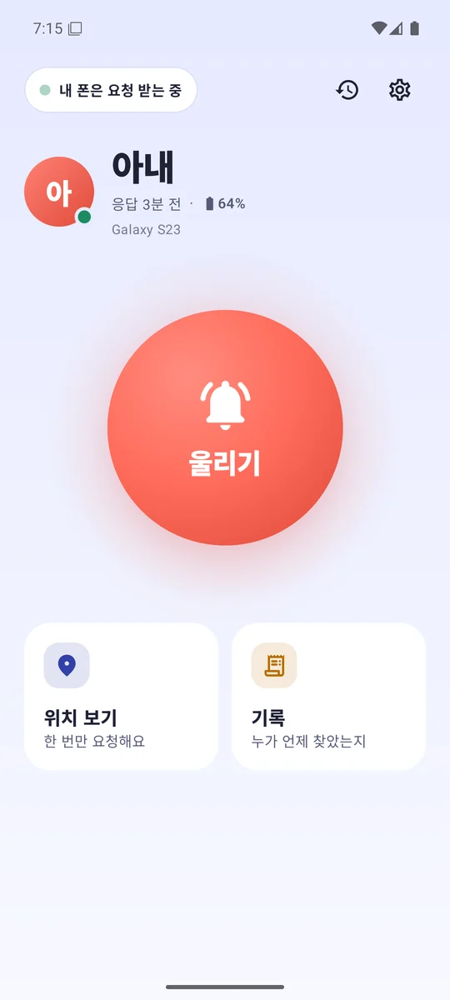
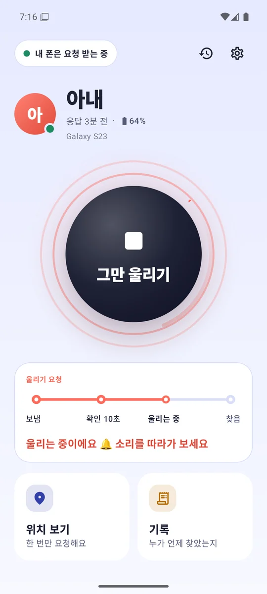
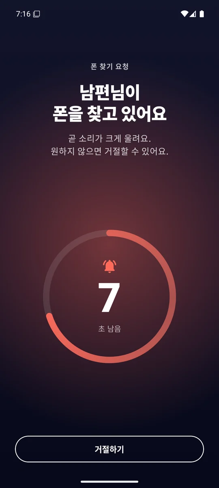
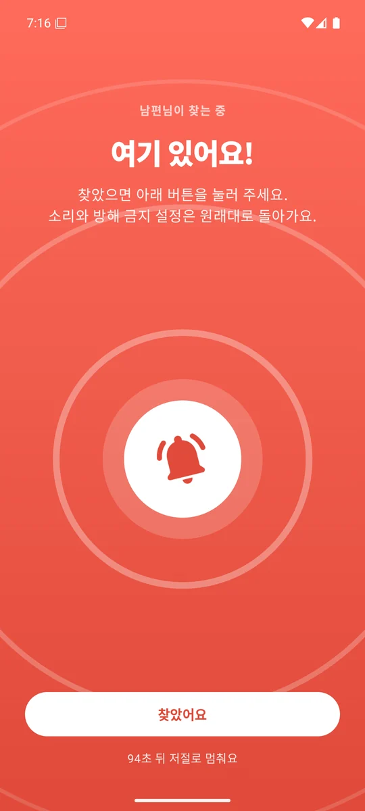
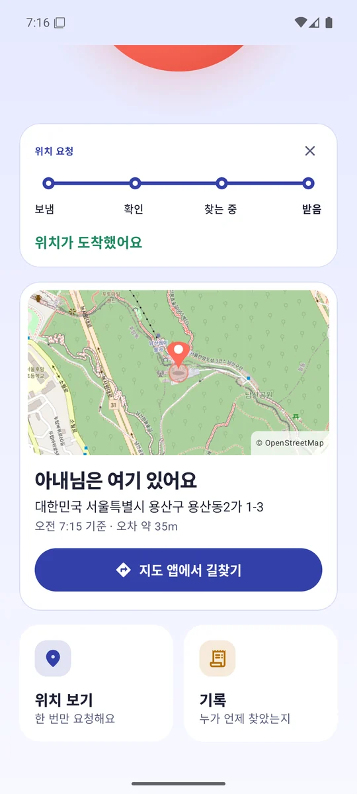
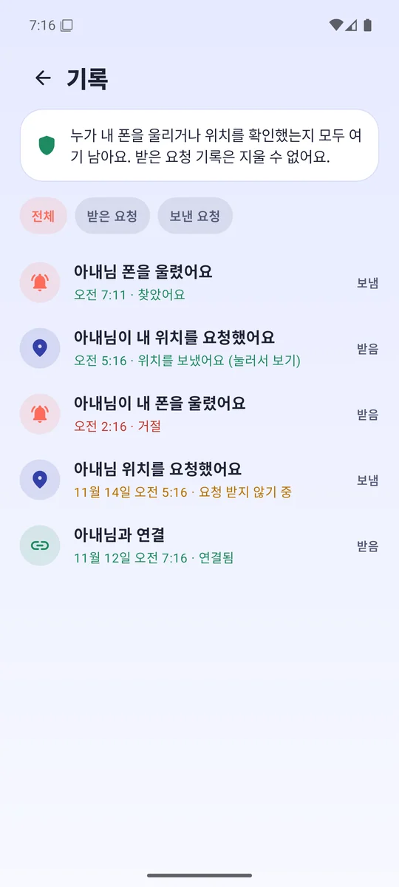
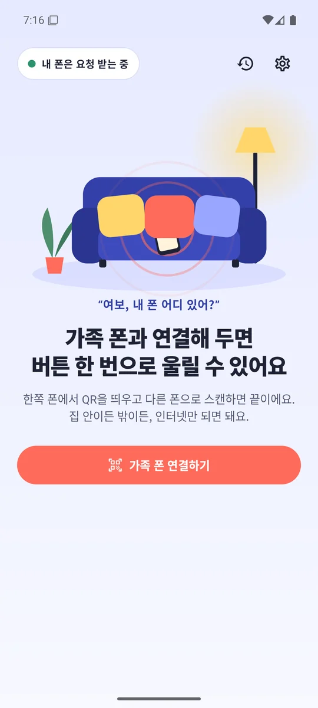
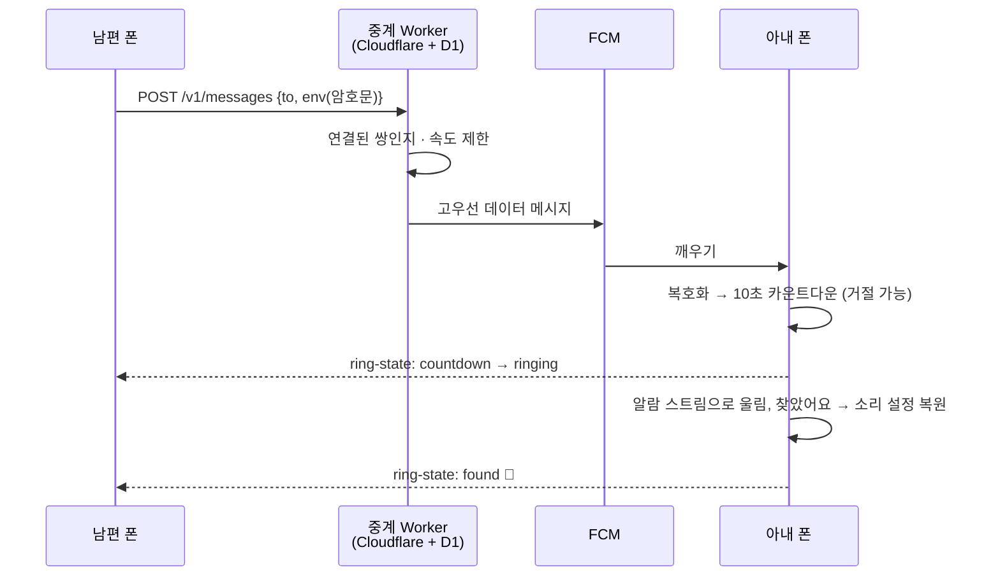

<div align="center">


# 폰 찾기 · Find My Wife Phone

**소파 밑에 있어도, 버튼 한 번이면 울려요.**<br>
무음·방해 금지여도 크게 울리고, 찾으면 소리 설정이 원래대로 돌아가는 가족용 Android 앱.

[](https://github.com/jeiel85/find-my-wife-phone/releases/latest)


[](LICENSE)

[랜딩 페이지](https://jeiel85.github.io/find-my-wife-phone/) · [APK 받기](https://github.com/jeiel85/find-my-wife-phone/releases/latest/download/find-my-wife-phone.apk) · [프로토콜](design/PROTOCOL.md) · [설계 결정](DECISIONS.md)

</div>

---

“여보, 내 폰 어디 있는지 알아?” 하고 물을 때 바로 답할 수 있도록 만든 앱입니다. 두 폰을 QR로 한 번 연결해 두면,
같은 Wi-Fi든 밖이든 인터넷만 되면 서로의 폰을 울리거나 위치를 확인할 수 있습니다.

<table>
<tr>
<td align="center"><br><sub>찾는 폰 · 버튼 하나</sub></td>
<td align="center"><br><sub>단계별 진행 상황</sub></td>
<td align="center"><br><sub>찾아지는 폰 · 10초 거절 창</sub></td>
<td align="center"><br><sub>여기 있어요!</sub></td>
</tr>
<tr>
<td align="center"><br><sub>위치는 한 번만, 지도로</sub></td>
<td align="center"><br><sub>지울 수 없는 기록</sub></td>
<td align="center"><br><sub>처음 화면</sub></td>
<td></td>
</tr>
</table>

## 무엇을 하나요

| | |
|---|---|
| 🔔 **울리기** | 알람 소리로 울려서 무음·진동 모드를 뚫습니다. 방해 금지 접근을 허용하면 방해 금지 중에도 울립니다. 볼륨은 부드럽게 시작해 최대로 커지고, 최대 2분 뒤 저절로 멈춥니다. |
| ↩️ **원래대로** | ‘찾았어요’를 누르면 볼륨과 방해 금지 상태가 울리기 전 그대로 돌아갑니다. 울리는 도중 앱이 죽거나 재부팅돼도 다음 실행 때 복원합니다. |
| ✋ **10초 거절 창** | 요청이 오면 잠금 화면 위에 “○○님이 폰을 찾고 있어요”가 10초 동안 뜨고, 그사이 거절할 수 있습니다. |
| 🌙 **요청 받지 않기** | 30분 · 1시간 · 3시간 · 내일 아침 8시까지 · 직접 끌 때까지. 상대 화면에도 “받지 않는 중”이 보입니다. |
| 📍 **위치 보기** | 받는 사람이 정책을 고릅니다: 알리고 10초 뒤 보내기(기본) / 내가 허용할 때만 / 보내지 않기. 보낼 때마다 알림이 뜹니다. |
| 🧾 **지울 수 없는 기록** | 누가 언제 내 폰을 울리고 위치를 확인했는지 모두 남고, 받은 요청 기록은 지울 수 없습니다. |
| 🔒 **종단 암호화** | 중계 서버와 Google(FCM)은 메시지 내용을 볼 수 없습니다. 키는 QR 안의 일회용 비밀값으로만 만들어집니다. |

## 어떻게 동작하나요



폰은 잠들어 있어 직접 접속을 받을 수 없습니다. 그래서 같은 개발자의 PC용 앱처럼 LAN·Tailscale로 직접 붙는 대신,
작은 Cloudflare Worker가 FCM으로 상대 폰을 **깨우기만** 합니다. Worker는 “어떤 기기끼리 연결됐는지”와 푸시 토큰만 알고,
울리기인지 위치인지, 좌표·배터리·이름은 모릅니다. 자세한 이유는 [DECISIONS.md D-2](DECISIONS.md)에 있습니다.

```
android/   Android 앱 (Kotlin · Jetpack Compose · FCM · Play services location)
relay/     중계 Worker (Cloudflare Workers · D1) + 테스트
docs/      랜딩 페이지와 QR 페어링 안내 페이지 (GitHub Pages)
design/    프로토콜 문서, 아이콘·알림음 생성 스크립트
```

## 설치

1. 두 폰 모두 [최신 APK](https://github.com/jeiel85/find-my-wife-phone/releases/latest/download/find-my-wife-phone.apk)를 받아 설치합니다(Android 10 이상, Google Play 서비스 필요).
2. 앱에서 가족에게 보일 이름(예: 아내, 남편)을 정하고, 알림 · 잠금 화면 표시 · 방해 금지 접근 · 위치(항상 허용)를 켭니다.
   삼성 폰은 **배터리 최적화 제외**도 켜 두는 것을 권장합니다.
3. 한 폰에서 **내 QR 보여주기**, 다른 폰에서 **QR 스캔하기**. QR은 10분 동안 한 번만 쓸 수 있습니다.

릴리스마다 APK의 SHA-256을 릴리스 노트에 적습니다.

## 직접 빌드하기

중계 서버와 Firebase 프로젝트는 배포자마다 따로 둡니다.

```bash
# 1) 중계
cd relay && npm ci && npm test
npx wrangler d1 create find-my-wife-phone-relay      # 나온 id를 wrangler.toml에
npx wrangler d1 migrations apply find-my-wife-phone-relay --remote
npx wrangler secret put FCM_SERVICE_ACCOUNT < service-account.json   # Firebase 서비스 계정 키
npx wrangler deploy

# 2) 앱 — Firebase 콘솔에서 받은 google-services.json을 android/app/에
cd android && ./gradlew testDebugUnitTest assembleDebug -Papp.relayUrl=https://<your-worker>.workers.dev
```

`google-services.json`·서비스 계정 키·릴리스 키스토어는 `.gitignore`로 막혀 있어 저장소에 들어가지 않습니다.
`google-services.json` 없이 빌드하면 앱은 동작하는 척하지 않고 “푸시 설정이 없다”고 표시합니다.

## 한계

- **Android 전용**입니다. iPhone은 무음을 뚫는 알림에 Apple의 Critical Alerts 승인이 필요합니다.
- **인터넷이 필요**합니다. 집 공유기의 외부망이 끊기면 같은 집 안이어도 동작하지 않습니다.
- Google Play 서비스(FCM)가 없는 폰은 지원하지 않습니다.
- 사용자가 직접 켠 방해 금지를 Android 15+에서 앱이 끄지 못하는 경우가 있습니다. 이때도 방해 금지가 알람을 허용하면(기본값) 울립니다.

## 개인정보

중계 서버(Cloudflare D1)에 저장되는 것: 무작위 기기 ID, 토큰의 해시, FCM 토큰, 연결된 기기 쌍, 10분짜리 페어링 초대(비밀값의 해시),
요청 횟수 카운터(하루 뒤 삭제). 위치·이름·배터리·요청 종류는 저장하지도 볼 수도 없습니다.
앱 데이터는 백업·기기 이전에서 제외되고, 비밀값은 Android Keystore로 감싸 저장됩니다.
받은 위치를 지도로 그릴 때는 그 주변 지도 조각을 OpenStreetMap 타일 서버에서 받아옵니다(지도를 열 때만).

## 개발 메모

- 처음 설정: [design/FIREBASE_SETUP.md](design/FIREBASE_SETUP.md) → `scripts/finish-firebase.sh`
- 릴리스 전 실기기 체크리스트: [design/VERIFY.md](design/VERIFY.md) → `scripts/release.sh <버전>`
- 디버그 빌드에는 화면 검수용 `DemoActivity`가 있습니다(릴리스 빌드에는 포함되지 않음):
  `adb shell am start -S -n io.github.jeiel85.findmywifephone/.DemoActivity --es state ringing`

## 라이선스

[MIT](LICENSE)
